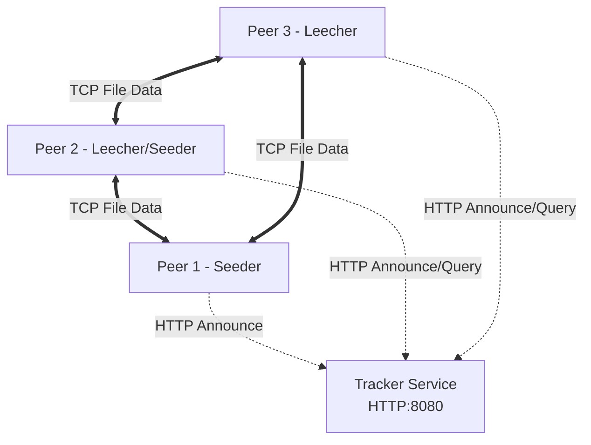
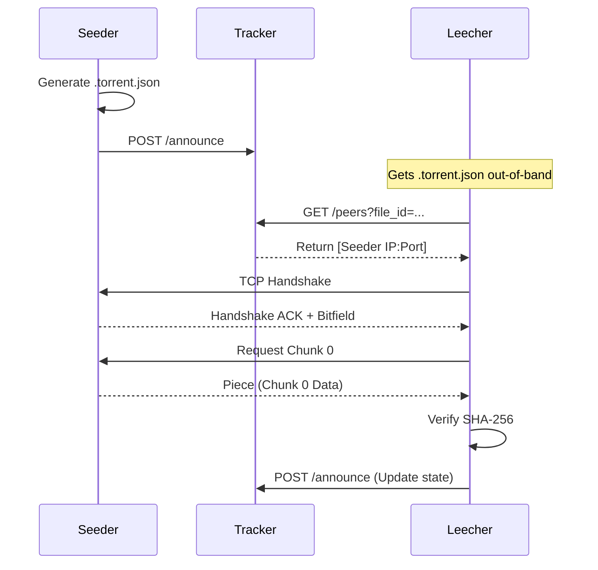
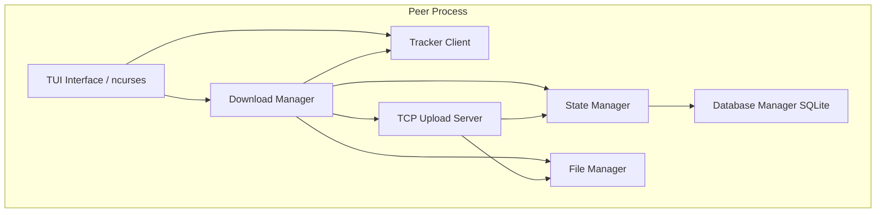

# Kiến trúc Hệ thống P2P File-Sharing (BitTorrent Clone)

## 1. Tổng quan hệ thống
Hệ thống P2P file-sharing này là một bản clone đơn giản hóa của BitTorrent, cho phép chia sẻ file phi tập trung giữa các máy tính (peer) với sự hỗ trợ của một máy chủ trung tâm (tracker). Hệ thống sử dụng các nguyên lý hệ thống phân tán cơ bản để đảm bảo hiệu suất và độ tin cậy.

**Các khái niệm phân tán chính:**
- **P2P (Peer-to-Peer):** Mạng ngang hàng, nơi mỗi node đóng vai trò vừa là client vừa là server.
- **Tracker:** Máy chủ điều phối trung tâm giúp các peer tìm thấy nhau, nhưng không trực tiếp lưu trữ hay chuyển tiếp dữ liệu file.
- **Data Chunking:** Chia nhỏ file lớn thành các phần (chunk) cố định để truyền tải và xác minh độc lập.
- **Parallel Downloading:** Tải nhiều chunk khác nhau từ nhiều peer cùng lúc để tối đa hóa băng thông.
- **Churn:** Hiện tượng các peer tham gia và rời khỏi mạng liên tục; hệ thống cần cơ chế heartbeat để quản lý.

**Tech Stack Summary:**

| Thành phần | Công nghệ sử dụng |
| :--- | :--- |
| Ngôn ngữ | C++17 |
| Build System | CMake |
| Network (P2P) | POSIX Sockets (TCP) |
| Network (HTTP) | Crow HTTP Framework |
| JSON Parsing | nlohmann/json |
| Hashing | OpenSSL SHA-256 |
| Database | SQLite3 |
| Terminal UI | ncurses |
| Concurrency | std::thread, std::mutex |

---

## 2. Các Service / Component
Hệ thống bao gồm chính xác 2 loại thực thi (executable):

### 2.1. Tracker Service (`tracker_app`)
- **HTTP server** sử dụng Crow framework.
- Quản lý **peer registry in-memory** sử dụng `std::unordered_map` kết hợp `std::mutex` để đảm bảo an toàn luồng.
- **Endpoints:**
  - `POST /announce`: Đăng ký hoặc cập nhật trạng thái của peer.
  - `GET /peers`: Lấy danh sách các peer đang giữ file.
  - `GET /health`: Kiểm tra trạng thái hoạt động của tracker.
- **Heartbeat timeout:** Tự động loại bỏ các peer không phản hồi (stale peers) sau **45 giây**.
- **Không lưu trữ hay truyền tải dữ liệu file.**
- **Không sử dụng database** (chỉ lưu in-memory, các peer sẽ tự động re-announce nếu tracker khởi động lại).

### 2.2. Peer Process (`peer_app`)
Đóng vai trò CẢ client (người tải - downloader) VÀ server (người đẩy - uploader) cùng lúc. Là một executable duy nhất với các chế độ CLI: `peer_app seed` và `peer_app download`.

Các sub-component chính:
- **Metadata Generator:** Chia file thành các chunk, tính toán SHA-256 hash cho từng chunk và toàn bộ file, tạo file `.torrent.json`.
- **TCP Upload Server:** Lắng nghe trên một port, chấp nhận kết nối từ các peer khác và phục vụ các chunk được yêu cầu.
- **Download Manager:** Kết nối TCP đến nhiều peer, tải các chunk song song sử dụng thread pool.
- **File Manager:** Đọc/ghi các chunk xuống ổ đĩa, ghép các chunk lại thành file hoàn chỉnh khi tải xong.
- **State Manager:** Quản lý `bitfield` (theo dõi chunk nào đã tải/đã xác minh).
- **Database Manager:** Wrapper cho SQLite3 - lưu trữ vĩnh viễn danh sách torrent, trạng thái chunk, lịch sử peer, và thống kê upload/download.
- **Tracker Client:** HTTP client để `announce` với tracker và truy vấn danh sách peer.
- **TUI Interface:** Giao diện dòng lệnh dùng `ncurses` hiển thị dashboard với danh sách torrent, thanh tiến trình (progress bar), bảng peer, tốc độ mạng, và log.

---

## 3. Kiến trúc vận hành (Operational Architecture)

**Quy trình từng bước:**
1. **Seeder** tạo metadata file (`.torrent.json`) từ file gốc.
2. Seeder đăng ký (`announce`) với **Tracker**.
3. **Leecher** nhận được metadata file (thông qua kênh ngoài - out-of-band).
4. Leecher truy vấn Tracker để lấy danh sách các peer đang có file.
5. Leecher kết nối trực tiếp với các peers qua TCP.
6. Leecher tải các chunk song song từ nhiều nguồn.
7. Khi tải xong, Leecher trở thành Seeder để chia sẻ lại cho mạng.

**Mermaid Diagram: System Architecture (Tracker + 3 Peers)**


**Mermaid Sequence Diagram: Complete Download Flow**


**Mermaid Diagram: Peer Internal Components**


- **Port assignments:** Tracker sử dụng port cố định **8080**, các peer sử dụng port động (dynamic) tự cấp phát.
- **Cách chạy 3+ peers trên cùng máy:** Sử dụng các thư mục cấu hình riêng biệt cho mỗi quá trình peer (ví dụ: cấp thư mục root khác nhau hoặc port khác nhau).
- **Định dạng Log:** `[TIMESTAMP] [COMPONENT] [LEVEL] message` (VD: `[2024-10-27 10:00:00] [DownloadMgr] [INFO] Starting download...`)

---

## 4. Giao thức giao tiếp (Communication Protocols)

### 4.1. Peer-to-Tracker (HTTP REST)
Giao tiếp giữa Peer và Tracker dùng HTTP/1.1 JSON:
- `POST /announce`: 
  - Body: `{"peer_id": "...", "ip": "...", "port": 1234, "file_id": "...", "bitfield": [true, false, ...]}`
- `GET /peers?file_id=xxx`: 
  - Response: `[{"peer_id": "...", "ip": "...", "port": 1234, "bitfield": [...]}]`
- `GET /health`: Kiểm tra sức khỏe (Health check)
- **Chu kỳ Re-announce:** 15 giây/lần. Tracker xóa peer sau 45 giây nếu không nhận được thông báo.

### 4.2. Peer-to-Peer Wire Protocol (Raw TCP)
Giao thức nhị phân (Binary Protocol). Mỗi tin nhắn có cấu trúc: `[Length (4 bytes)][Msg ID (1 byte)][Payload (variable)]`.

- **HANDSHAKE (0x00):** `{peer_id (16B), file_id (32B)}`
- **BITFIELD (0x01):** `{bitfield_bytes}`
- **REQUEST (0x02):** `{chunk_index (4B)}`
- **PIECE (0x03):** `{chunk_index (4B), data (variable length)}`
- **CANCEL (0x04):** `{chunk_index (4B)}`
- **KEEPALIVE (0x05):** (empty payload)

---

## 5. Cấu trúc dữ liệu chính (Key Data Structures)

- **Metadata (`.torrent.json`) Format:**
```json
{
  "file_id": "sha256_of_metadata",
  "file_name": "ubuntu.iso",
  "file_size": 1073741824,
  "chunk_size": 262144,
  "num_chunks": 4096,
  "file_hash": "sha256_of_entire_file",
  "chunk_hashes": ["hash0", "hash1", "..."]
}
```
- **Bitfield Representation:** Vector boolean hoặc bitset mô tả chunk nào đã tải thành công.
- **PeerInfo Struct (C++):** `struct PeerInfo { string peer_id; string ip; uint16_t port; vector<bool> bitfield; time_point last_seen; };`
- **Chunk Storage on Disk:** Mỗi chunk lưu tạm trên disk, tên file là index. Sau khi đủ số chunk, ghép lại thành file gốc.
- **Thread-safe Download Queue:** Hàng đợi chứa index các chunk cần tải, được bảo vệ bởi `std::mutex` và `std::condition_variable` phân bổ cho thread pool.

---

## 6. Lưu trữ State (State Storage)

### 6.1. Tracker - In-memory
- Trạng thái các peer được lưu trong RAM (`std::unordered_map`).
- Nếu tracker khởi động lại, dữ liệu bị mất, nhưng hệ thống tự phục hồi vì các peer sẽ `re-announce` lại theo chu kỳ 15 giây.

### 6.2. Peer - SQLite Database
Peer sử dụng SQLite3 cho TẤT CẢ các trạng thái cần lưu trữ vĩnh viễn (persistent state). File database mặc định: `~/.qbt-clone/peer.db`.

**Schema Database:**
```sql
CREATE TABLE torrents (
    file_id      TEXT PRIMARY KEY,
    file_name    TEXT NOT NULL,
    file_size    INTEGER NOT NULL,
    chunk_size   INTEGER NOT NULL,
    num_chunks   INTEGER NOT NULL,
    file_hash    TEXT NOT NULL,
    status       TEXT NOT NULL DEFAULT 'downloading',
    metadata_path TEXT NOT NULL,
    output_path  TEXT NOT NULL,
    uploaded     INTEGER DEFAULT 0,
    downloaded   INTEGER DEFAULT 0,
    added_at     DATETIME DEFAULT CURRENT_TIMESTAMP
);

CREATE TABLE chunks (
    file_id      TEXT NOT NULL,
    chunk_index  INTEGER NOT NULL,
    hash         TEXT NOT NULL,
    status       TEXT NOT NULL DEFAULT 'missing',
    PRIMARY KEY (file_id, chunk_index),
    FOREIGN KEY (file_id) REFERENCES torrents(file_id)
);

CREATE TABLE peer_history (
    peer_id      TEXT NOT NULL,
    ip           TEXT NOT NULL,
    port         INTEGER NOT NULL,
    file_id      TEXT NOT NULL,
    last_seen    DATETIME DEFAULT CURRENT_TIMESTAMP,
    PRIMARY KEY (peer_id, file_id),
    FOREIGN KEY (file_id) REFERENCES torrents(file_id)
);
```

**Cấu trúc thư mục ổ đĩa:**
```
~/.qbt-clone/
├── peer_config.json       # Chứa cấu hình chung và Peer ID
├── peer.db                # SQLite database lưu trạng thái
├── torrents/
│   └── <file_id>/
│       ├── metadata.torrent.json  # Bản copy của metadata
│       └── chunks/                # Các chunk tải dở
└── downloads/                     # Nơi chứa các file đã tải hoàn chỉnh
```

### 6.3. Quy trình Resume Download
Để cho phép tiếp tục tải khi bị gián đoạn:
1. **Khởi động Peer:** Đọc file `peer_config.json` để lấy cấu hình và ID.
2. **Nạp trạng thái:** Mở database `peer.db` → Thực hiện truy vấn `SELECT * FROM torrents`.
3. **Với các torrent đang seeding (`status = 'seeding'`):** Bắt đầu gửi `announce` tới tracker, mở port TCP Upload Server.
4. **Với các torrent đang tải dở (`status = 'downloading'`):** Truy vấn trạng thái từng chunk trong bảng `chunks` (tìm các chunk `status = 'missing'`), thêm vào hàng đợi tải (download queue) và tiếp tục tải từ mạng.
