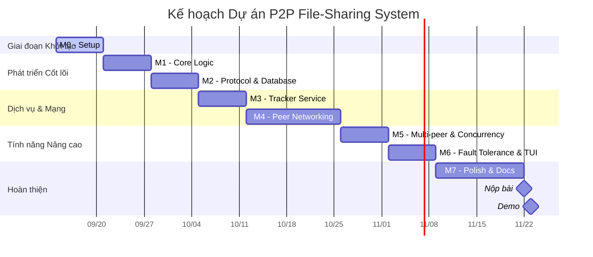

# Kế hoạch và Cột mốc Dự án (Milestones)

**Dự án:** Hệ thống chia sẻ file ngang hàng (P2P File-Sharing System - BitTorrent Clone)
**Ngôn ngữ:** C++17
**Bắt đầu:** 14/09/2026
**Hạn chót:** 22/11/2026
**Demo:** 23/11 hoặc 30/11/2026
**Thời lượng:** Khoảng 10 tuần

**Công nghệ sử dụng:** CMake, POSIX Sockets, Crow, nlohmann/json, OpenSSL, SQLite3, ncurses

## Sơ đồ Gantt Dự án

## Chi tiết các Cột mốc (Milestones)

### Milestone 0: Setup (Tuần 1: 14/09 - 21/09)
- [x] Cài đặt toolchain: `g++`, `cmake`, `openssl`, `asio` (nếu có), `nlohmann-json`, `crow`, `ncurses`, `sqlite3`
- [X] Tạo cấu trúc thư mục dự án (áp dụng `include/` và `common/` pattern)
- [X] Viết cấu hình `CMakeLists.txt` cho thư mục gốc (root) và các module (subs)
- [X] Build test chương trình "Hello World"
- [ ] Cấu hình `.gitignore`, thực hiện initial commit
- [ ] Thiết lập framework Google Test cho Unit testing

### Milestone 1: Core Logic (Tuần 2: 21/09 - 28/09)
- [X] Xây dựng wrapper cho hàm băm SHA256
- [X] Xử lý metadata: tạo, lưu trữ và nạp file `.torrent.json`
- [X] Xây dựng `file_manager`: chức năng chia nhỏ (split), đọc, ghi và ghép (merge) file
- [X] Triển khai hệ thống logger
- [ ] Viết Unit tests cho các chức năng trên
**Sản phẩm (Deliverable):** Có thể tạo file `.torrent.json` và tái tạo lại file hoàn chỉnh từ các mảnh (chunks) nhỏ.

### Milestone 2: Wire Protocol + Database (Tuần 3: 28/09 - 05/10)
- [x] Thiết kế và cài đặt protocol: serialize/deserialize dữ liệu với network byte order
- [x] Xây dựng module `database.hpp/cpp`: wrapper cho SQLite bao gồm việc tạo schema, và các thao tác CRUD cho torrents, chunks, và peer_history
- [x] Viết Unit tests: kiểm tra quy trình gửi nhận của protocol (roundtrip), và các thao tác database
**Sản phẩm (Deliverable):** Encoding của protocol hoạt động chính xác, các thao tác CRUD với database thành công.

### Milestone 3: Tracker Service (Tuần 4: 05/10 - 12/10)
- [ ] Xây dựng `peer_registry`: đảm bảo an toàn luồng (thread-safe) và cơ chế dọn dẹp các peer hết hạn (timeout cleanup)
- [ ] Triển khai `tracker_server` với các endpoint (routes) sử dụng Crow
- [ ] Hoàn thiện `tracker/main.cpp`
- [ ] Viết Unit và Integration tests
**Sản phẩm (Deliverable):** Tracker service hoạt động cơ bản, có khả năng nhận và xử lý request.

### Milestone 4: Peer Networking (Tuần 5-6: 12/10 - 26/10)
- [ ] Xây dựng `tracker_client` (giao tiếp HTTP, thực hiện announce định kỳ với Tracker)
- [ ] Triển khai `upload_server` (giao tiếp TCP, xử lý đa luồng - multi-thread)
- [ ] Triển khai `download_manager` (quản lý việc chọn chunk, áp dụng thread pool, và cơ chế thử lại - retry)
- [ ] Xây dựng `state_manager` (sử dụng bitfield, tích hợp chặt chẽ với SQLite để theo dõi trạng thái file)
- [ ] Xây dựng `peer_node` để điều phối hoạt động
- [ ] Hoàn thiện `peer/main.cpp` giao diện CLI
**Sản phẩm (Deliverable):** Chuyển file ngang hàng (P2P) thành công giữa 2 peers.

### Milestone 5: Multi-peer & Concurrency (Tuần 7: 26/10 - 02/11)
- [ ] Kiểm thử với mạng gồm 3+ peers
- [ ] Hỗ trợ tải xuống song song từ nhiều nguồn (sources) khác nhau
- [ ] Tính năng vừa upload vừa download đồng thời
- [ ] Cơ chế giới hạn số lượng kết nối (Connection limiting)
- [ ] Viết các Concurrency tests
**Sản phẩm (Deliverable):** Quá trình tải xuống song song từ nhiều peer hoạt động trơn tru.

### Milestone 6: Fault Tolerance + TUI (Tuần 8: 02/11 - 09/11)
- [ ] Đảm bảo vượt qua toàn bộ 7 kịch bản demo bắt buộc
- [ ] Phát triển giao diện người dùng Text-based (TUI) bằng ncurses: bao gồm dashboard, thanh tiến trình (progress bars), bảng danh sách peer, panel log, và điều khiển bằng bàn phím
- [ ] Thực hiện kiểm thử khả năng chịu lỗi (Fault tolerance tests)
- [ ] Kiểm tra bảo mật (Security tests) cơ bản
- [ ] Chuẩn bị các kịch bản demo (Demo scripts)
**Sản phẩm (Deliverable):** Mọi kịch bản demo pass, giao diện TUI hoạt động tốt và trực quan.

### Milestone 7: Polish & Docs (Tuần 9-10: 09/11 - 22/11)
- [ ] Đóng gói với Docker (nếu cần thiết cho việc demo)
- [ ] Kiểm tra hiệu năng (Performance testing)
- [ ] Hoàn thiện file `README.md`
- [ ] Viết Báo cáo (Report) từ 20-30 trang
- [ ] Chuẩn bị Slides thuyết trình
- [ ] Dọn dẹp mã nguồn (Code cleanup)
- [ ] Tạo file `.env.example`
- [ ] Final test toàn bộ hệ thống
- [ ] Đánh dấu Git tag `v1.0.0`
**Sản phẩm (Deliverable):** Sẵn sàng để nộp bài dự án.

## Phân tích Rủi ro & Biện pháp Giảm thiểu (Risk & Mitigation)

- **Sự phức tạp của POSIX Sockets:** Lập trình mạng mức thấp thường dễ gặp lỗi. *Biện pháp:* Bắt đầu với cách tiếp cận đơn giản nhất, đảm bảo tính đúng đắn trước khi tối ưu hóa đa luồng.
- **Áp lực Thời gian (Time pressure):** Thời hạn 10 tuần là khá eo hẹp. *Biện pháp:* Các Milestone M0-M4 là đường găng (critical path). Cần tập trung hoàn thành đúng hạn các cột mốc này; các tính năng phụ có thể cắt giảm nếu cần.
- **SQLite Thread Safety:** Vấn đề truy cập đồng thời vào CSDL. *Biện pháp:* Bật chế độ WAL (Write-Ahead Logging) cho SQLite ngay từ đầu để hỗ trợ đồng thời (concurrency) tốt hơn.
